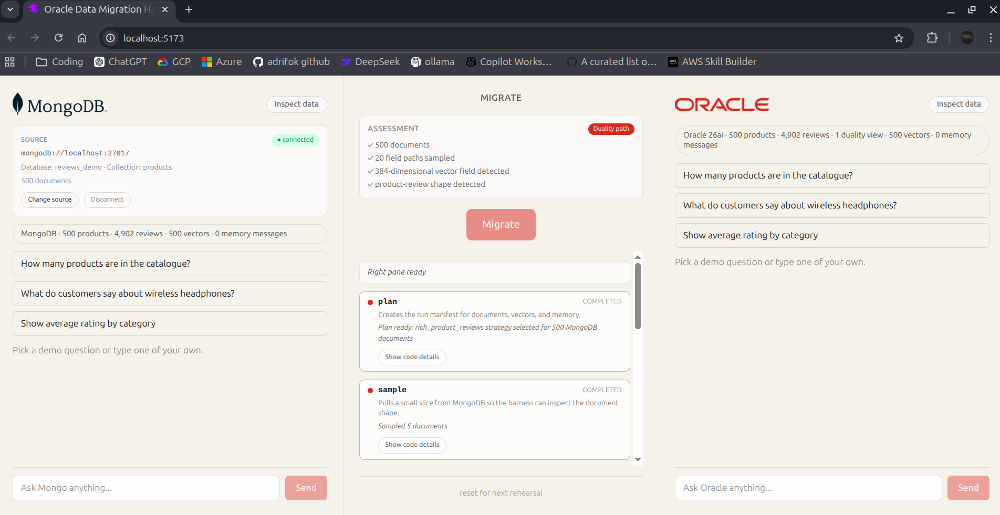
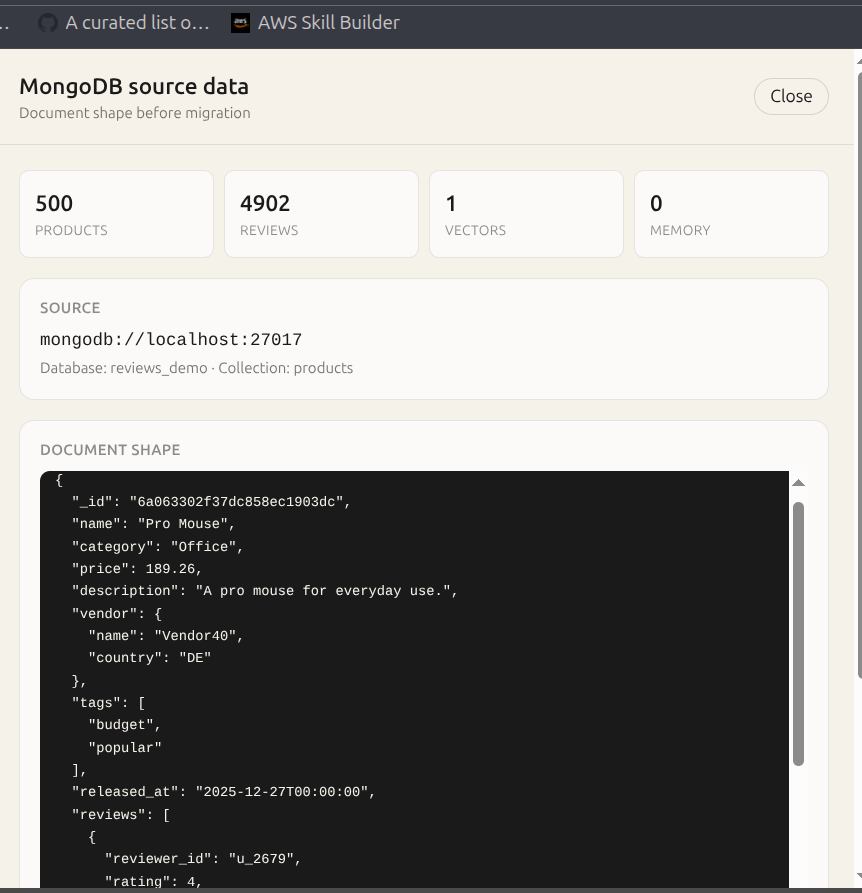
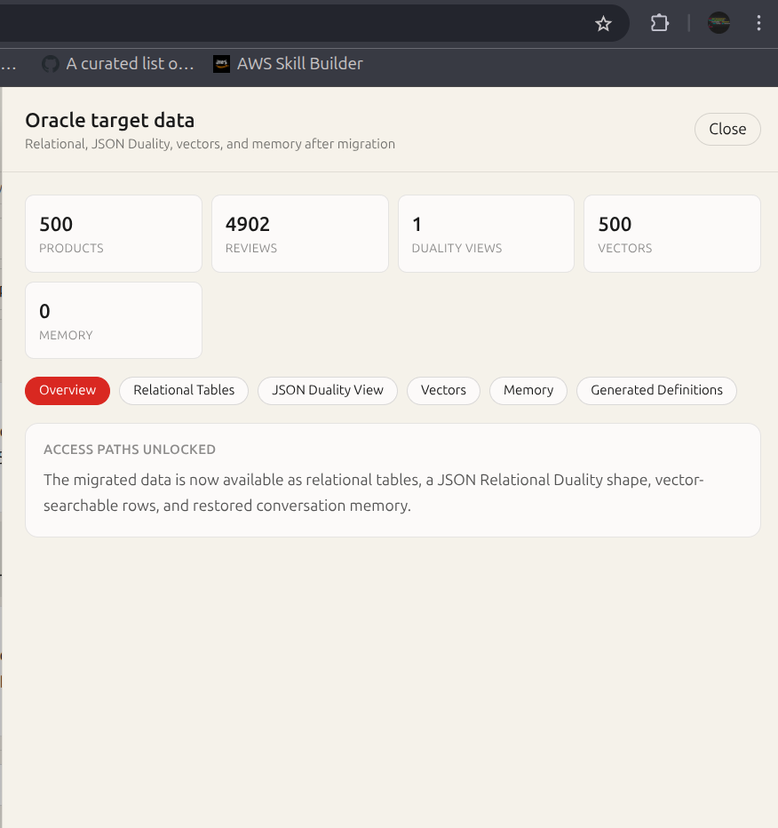

oracle-migration-harness-iac

Terraform for the AWS box that runs Oracle's data migration harness, an AI agent that moves a RAG corpus from MongoDB to Oracle AI Database 26ai.

The harness is Oracle's, from oracle-devrel/oracle-ai-developer-hub (apps/oracle-data-migration-harness). I did not write the agent. This repo is the infrastructure I built to run it, plus what it took to get it working end to end.

What the agent does

  It walks a 7-stage state machine: it plans the run, samples the MongoDB documents to learn their shape, then moves the data to Oracle as relational tables, a JSON Relational Duality view, vector-searchable rows and conversation memory. An LLM (xai.grok-3-fast on OCI Generative AI) drives the decisions, and embeddings are computed locally with sentence-transformers/all-MiniLM-L6-v2 (384 dimensions).

Result

  500 products, 4,902 reviews and 500 vectors migrated from MongoDB to Oracle 26ai, with one Duality view created on the Oracle side.

  
  
  

Why AWS for an Oracle app

  The plan was an OCI Ampere A1 VM, but free-tier A1 capacity in sa-santiago-1 was never available. I moved the compute to an AWS Graviton instance and kept the LLM on OCI. The VM calls OCI Generative AI over HTTPS, so it is a cross-cloud setup: compute in AWS us-east-1, model in OCI us-chicago-1.

What gets created (8 resources)

  networking-aws   VPC, public subnet, internet gateway, route table and association, security group
  compute-aws      SSH key pair and an EC2 t4g.medium (ARM64, 4 GB RAM, Ubuntu 22.04, 30 GB gp3)

  The security group only allows my IP, on SSH (22), the FastAPI backend (8000) and the Vite UI (5173). cloud-init installs Docker, Python 3.11 and Node.js 20 on first boot.

Deploy

  cp terraform.tfvars.example terraform.tfvars
  terraform init
  terraform plan -out=tfplan
  terraform apply tfplan
  terraform output ec2_public_ip

Run the harness on the VM

  1. Copy the OCI credentials, needed for the Generative AI calls:

     scp -r ~/.oci ubuntu@<EC2_IP>:~/.oci

  2. SSH in, clone oracle-ai-developer-hub, go to apps/oracle-data-migration-harness and create .env from its example. Set LLM_PROVIDER=oci_genai, LLM_MODEL=xai.grok-3-fast, OCI_REGION=us-chicago-1 and EMBEDDING_PROVIDER=local.

  3. Install, start the databases and wait for Oracle:

     make install
     docker pull docker.io/gvenzl/oracle-free:latest && docker pull mongo:7
     docker logs -f oracle-free 2>&1 | grep -m1 "DATABASE IS READY TO USE"

  4. Create the Oracle user (SQL block in the upstream README), load and embed the data, then start the backend and the UI in two terminals:

     make seed && make embed
     make app
     make ui

  5. From your laptop, tunnel both ports and open http://localhost:5173:

     ssh -L 8000:localhost:8000 -L 5173:localhost:5173 ubuntu@<EC2_IP>

Things that bit me

  The upstream quick start uses podman. On Ubuntu I used docker, same commands.

  The Oracle Free image is about 3 GB and takes a couple of minutes to be ready. Starting the seed before "DATABASE IS READY TO USE" fails.

  A .env with leading spaces on each line, from pasting, breaks the config silently. Write it clean.

Known trade-offs

  The VM sits in a public subnet with a public IP. The security group limits it to one IP, which is fine for a lab. In production it would sit in a private subnet behind SSM Session Manager.

  The OCI API key is copied to the VM. Something like OCI workload identity, or a short-lived key, would be better.

  The databases run as containers on the same VM, with no backups. That is enough for a demo, not for a real migration.

Clean up

  The instance costs about 0.03 USD an hour. Destroy it when you're done:

  terraform plan -destroy
  terraform destroy
